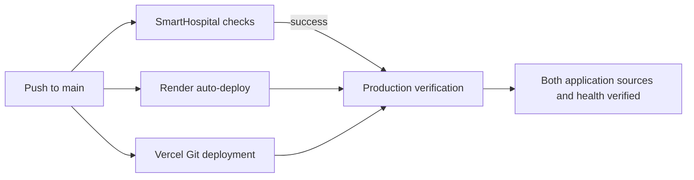

# Production deployment verification

SmartHospital keeps the existing Git integrations: Render and Vercel perform
the deployments. GitHub Actions verifies the release after CI passes. This is
the native auto-deploy model selected for the current free infrastructure;
it does not move deployment credentials into GitHub.

## Provider settings

- Render: **Auto-Deploy = On Commit**, as confirmed for this service. Keep
  `npm run start:deploy`, the Supabase CA configuration and `/health/ready`.
  The observer is a GitHub check that waits for Render. Making Render wait for
  all checks on the same commit can create a dependency cycle, so do not change
  this selected model to After CI Checks Pass without redesigning that gate.
- Vercel: keep the Git integration and Production Branch `main`. Enable access
  to **System Environment Variables** so the build receives
  `VERCEL_GIT_COMMIT_SHA`. Do not manually pin a commit SHA in provider settings.
- A Git push may start native deployments before CI completes. Only the
  verification workflow waits for CI success. A failed CI does not cancel an
  already-started native deployment. Gating every deployment on CI would require
  the alternative Actions-driven deployment model and provider credentials.

## What the workflow proves

`.github/workflows/cd.yml` runs after **SmartHospital checks** completes
successfully for a same-repository `push` to `main`. Pull requests, forks,
failed CI and non-main branches do not run production probes. Permissions are
read-only (`contents: read`, `actions: read`). Verification code is checked out
from the workflow's default-branch snapshot; the expected CI revision
comes separately from the triggering CI run's `head_sha`, not `GITHUB_SHA`.

`scripts/verify-deployment.mjs` independently checks that successful main-push
CI exists for the exact SHA and that it remains the current main head. It then
waits for all of these public, read-only checks:

| Endpoint | Required result |
| --- | --- |
| Backend `/health/version` | Tested SHA, or proven identical backend source at an ancestor SHA |
| Backend `/health/ready` | HTTP 200 and `status: ready` |
| Frontend `/deployment.json` | Tested SHA, or proven identical frontend source/config at an ancestor SHA |
| Frontend `/` | HTTP 200 and the HTML application shell |

Native monorepo integrations can skip CI/docs-only commits outside an app's
Root Directory. For a different live SHA, the verifier requires GitHub compare
metadata proving the live commit is an ancestor of the CI commit. It then
compares immutable Git trees: backend `sh.server`; frontend `sh.client` plus
the root `vercel.json` blob. Only identical inputs are accepted. If shared
runtime/build inputs are added outside these paths, extend this source map.
Git objects are cached within a run; the mutable main head is always rechecked.

The summary records the CI SHA, each actual deployed SHA, and whether each
match is exact or source-equivalent. It never relabels an old runtime as a new
deployment. Both actual identities are checked again after health/page probes.
A healthy old release with changed app source, a divergent/newer commit,
generic SPA HTML at the JSON path, missing revision, redirect or malformed
response is not a successful verification. Responses and provider
error bodies are never printed. GitHub authorization is sent only to the fixed
GitHub API origin, never to the production endpoints.

The script polls about every 15 seconds for up to 15 minutes, with individual
requests capped at 10 seconds. The job is capped at 20 minutes. If main advances,
the old run reports **superseded**, not a verified deployment. Concurrency is
scoped to eligible jobs and the exact revision: a duplicate observer of the
same SHA can replace its previous observer, while an old CI rerun, failed CI
or fork cannot cancel verification of a different current revision. No observer
cancels a provider deployment. The summary records the SHA or why it stopped.

This is HTTP release/readiness evidence. It does not replace authenticated
clinical workflow UAT, payment reconciliation, provider testing, backup/restore
rehearsals or a browser-based acceptance run.

## Configuration and manual retry

The workflow uses GitHub's automatically supplied `GITHUB_TOKEN` with read-only
permissions. No new repository secret is required. The default targets are:

- API: `https://smart-hospital-api-6y6v.onrender.com`
- Web: `https://smart-hospital-rouge.vercel.app`

If the production domains change, set optional repository **variables** under
Settings, Secrets and variables, Actions, Variables:
`PRODUCTION_API_URL` and `PRODUCTION_WEB_URL`. Use public HTTPS base URLs without
credentials, query strings or fragments. No database/Redis URL belongs here.

For a retry, open Actions, **SmartHospital deployment verification**, Run
workflow, and select `main`. This checks the current main revision and still
requires a passing main-push CI for that revision. It does not trigger a new
Render/Vercel deployment. Restart or redeploy from the provider only after
investigating its logs. Production migration commands remain on Render.

The backend gets its revision from `RENDER_GIT_COMMIT` (fallback `APP_REVISION`
for non-Render deployments). Frontend builds use `VERCEL_GIT_COMMIT_SHA`, then
`GITHUB_SHA`, then `APP_REVISION`. Only a full 40-character hexadecimal SHA is
published, normalized to lowercase. An invalid first-defined provider value
returns `null`; unrelated lower-priority values do not hide missing metadata.
Both public identity responses use `Cache-Control: no-store`.

## Validation

Run `node --test scripts/verify-deployment.test.mjs` using Node 22. CI includes
this dependency-free suite. Fixtures cover stale releases, superseded commits,
failed/fork/PR CI, ancestor/tree equivalence, warming readiness, missing/invalid metadata, redirects/body
failures, credential isolation and bounded response sizes. Identity-specific
tests run with the frontend and backend suites. Local fixtures prove verifier
behavior; the remote CD run proves the currently deployed provider revisions.

References: [GitHub workflow_run](https://docs.github.com/en/actions/reference/workflows-and-actions/events-that-trigger-workflows#workflow_run),
[Render auto-deploy](https://render.com/docs/deploys#automatic-deploys),
[Render revision variable](https://render.com/docs/environment-variables),
[Vercel system variables](https://vercel.com/docs/environment-variables/system-environment-variables).
